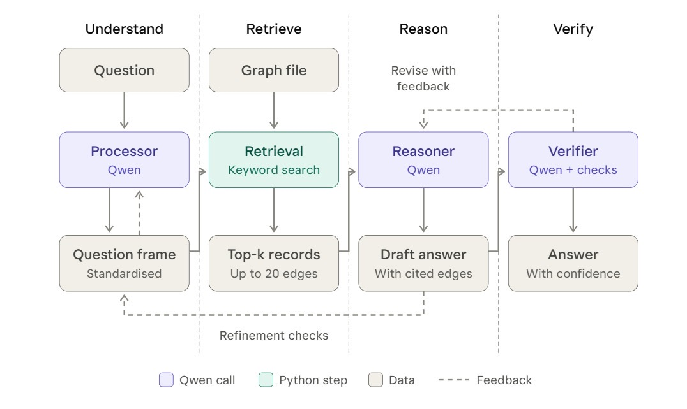
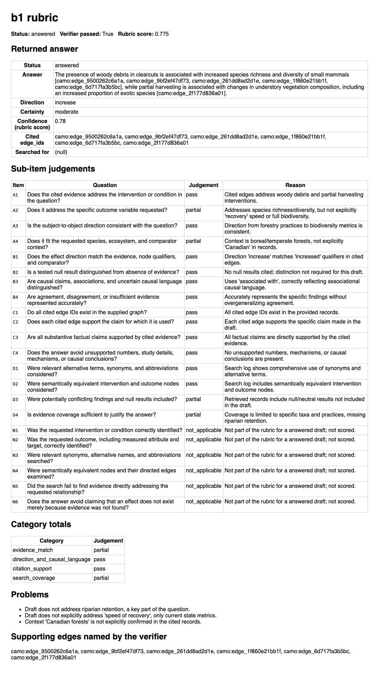
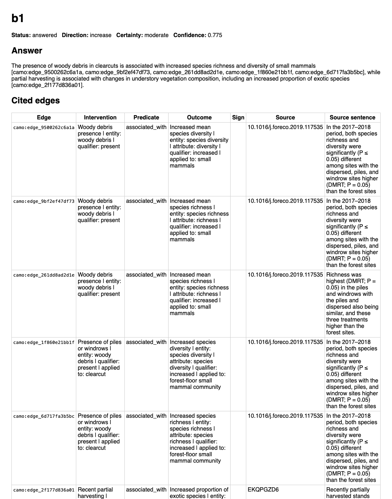

# CAUSA NOSTRA

**Evidence Jam 2026 · Lane 2 — Reasoning**

CAUSA NOSTRA answers ecology questions using the supplied Causal Mosaic (CAMO) graph. Instead of giving a general answer from a language model, it looks for relevant claims in `causal_graph.json`, uses those claims to write an answer, and checks whether the answer is supported.

The program does not search the web. It can only answer from evidence found in the supplied graph.

## Solution architecture



## Run the project

From the project folder, run:

```bash
./run.sh questions.yaml answers.json
```

On Windows, use PowerShell:

```powershell
py -m uv run --locked python -m causa_nostra.cli run .\questions.yaml .\answers.json --graph .\causal_graph.json
```

The script accepts a different question file in the same format. This includes the hidden question file used during judging.

The results are written to `answers.json`. The program saves the file after each question, so an interrupted run may leave a partial set of results.

### Set up the model connection

Set these environment variables before running the program:

| Variable | What it is |
| --- | --- |
| `BRINE_URL` | URL of the OpenAI-compatible model endpoint |
| `BRINE_MODEL` | Model name (`Qwen3.8-27B` for judging) |
| `BRINE_API_KEY` | API key for the endpoint |

For example, in PowerShell:

```powershell
$env:BRINE_URL = "your endpoint URL"
$env:BRINE_MODEL = "your model name"
$env:BRINE_API_KEY = "your API key"
```

You can also put these settings in a local `.env` file for `run.sh`. Never commit `.env` or API keys to the repository.

Dependencies are pinned in `uv.lock` and the run script uses `uv run --locked`. Install `uv` and prepare the locked environment before running if needed. The answering pipeline makes no web requests; its external calls go to the configured model endpoint. Make sure dependencies are available locally when running under the competition's no-download rule.

## Questions and answers

Questions are supplied in a YAML file. Every question needs a unique `id` and a `question`. The optional `kind` field is for organizing questions; it does not currently change how they are processed.

```yaml
questions:
  - id: Q01
    question: Does fertilization affect seedling growth?
  - id: Q02
    question: Does deer browsing affect seedling survival?
```

Questions that ask about one intervention or condition and one outcome are easiest to check. The program may have difficulty with broader questions that combine several effects.

Each output entry contains a short answer and the information needed to check it:

| Field | Meaning |
| --- | --- |
| `status` | `answered` or `no_evidence` |
| `answer` | The answer in plain language, or why no supported answer was produced |
| `direction` | `increase`, `decrease`, `no_effect`, `mixed`, or `unclear`; null for `no_evidence` |
| `certainty` | Evidence strength: `high`, `moderate`, `low`, or `very_low` |
| `confidence` | The pipeline's confidence score, between 0 and 1 |
| `edge_ids` | IDs of the graph claims used as evidence |
| `searched_for` | What was searched when no evidence was found |
| `extras` | Optional paths to additional output files |

`no_effect` means evidence reports a null result. It is different from `no_evidence`, which means the program could not establish an answer from the graph. A processing error can also produce a fallback `no_evidence` entry; the accompanying explanation should make that clear.

### Output file and extras

The output file (the path passed as the second argument to `run.sh`) is a JSON object with two top-level keys:

```json
{
  "team": "CAUSA NOSTRA",
  "answers": [
    {
      "id": "<question id>",
      "status": "answered | no_evidence",
      "answer": "<short plain-language answer>",
      "direction": "increase | decrease | no_effect | mixed | unclear | null",
      "confidence": 0.0,
      "certainty": "high | moderate | low | very_low | null",
      "edge_ids": ["camo:edge_<hash>"],
      "searched_for": "<search description> | null",
      "extras": ["<repo-relative path>"]
    }
  ]
}
```

- `team` is always `"CAUSA NOSTRA"`.
- `answers` holds exactly one entry per input question, in the original question order. Each `id` comes from the question file and is used as given.
- `edge_ids` lists graph edge IDs from `causal_graph.json` (the `camo:edge_` prefix plus a hash). Every ID is checked against the graph before the file is written, and invalid IDs are removed.
- `direction` and `certainty` are null for `no_evidence` entries. `edge_ids` is empty for them, and `searched_for` describes what was checked.
- `searched_for` is null for `answered` entries.
- `extras` is empty or lists existing files in the `<answers-stem>_evidence/` folder, described above.
- `confidence` is a number between 0 and 1.

The file is valid JSON and the entries follow the competition format. Fields are not added or renamed, so downstream scripts can read every entry the same way. `answers.json` is the competition deliverable; the other files are optional extras that help a reader check the answer.

Each run also writes a folder next to the answers file, named `<answers-stem>_evidence/`. Extras are referenced by repo-relative path in each entry's `extras` list:

| File | Written for | Contents |
| --- | --- | --- |
| `<id>_evidence.html` | `answered` entries only | The question's cited edges, their source sentences, and source document references. Open it to check each claim against the graph. |
| `<id>_rubric.html` | Every entry the verifier scored | The verifier's rubric judgments (pass / partial / fail), short explanations, and the weighted score used as `confidence`. For `no_evidence` entries, this page shows the missing-evidence rubric and the search summary. |

The image below is an example of a `<id>_rubric.html` page for an `answered` entry, rendered as a PNG. It shows the returned answer and its fields, the sub-item judgments grouped by category, category totals, and the problems the verifier raised:



The image below is an example of an `<id>_evidence.html` page for the same `answered` entry. It lists each cited edge with its intervention, predicate, outcome, source document, and source sentence, so each claim can be checked against the graph:



Things to know when reading the output:

- `no_evidence` entries have no `_evidence.html` page, because they cite no edges.
- Fallback entries created after a processing error have an empty `extras` list and a `searched_for` value of `not searched: pipeline error…`. They are not evidence-based conclusions; rerun the question before relying on them.
- `confidence` is a rubric-based score, not a calibrated probability. A `confidence` of `1.0` on a `no_evidence` entry means the missing-evidence rubric was fully satisfied, not that the graph is certain to lack the relationship.

## How it works

1. **Read the question.** A model identifies the intervention or condition, the outcome, any stated context, and alternative search terms. These alternative terms help with wording differences but are not treated as automatically equivalent.
2. **Find evidence.** The program loads the local CAMO graph, turns edges into readable records, and searches subject and object indexes separately. It looks for claims that connect the requested intervention to the requested outcome, not just records that happen to mention similar words. By default, it passes up to 20 ranked records to the next stage.
3. **Write an answer.** The reasoning model uses the retrieved records to draft a short response. It cites edge IDs and should not add outside facts or join separate edges into an unsupported causal claim.
4. **Verify the draft.** The program checks cited edge IDs, then asks a verifier to review the draft against the evidence and rubric. If the review fails, the reasoner can revise its answer once by default.
5. **Save the result.** Python applies the rubric rules and checks the final output. Invalid citations and file references are removed. If an answer has no valid supporting citation, it becomes a fallback entry. Questions are saved in their original order.

### What the verification step checks

The verifier receives the original question, the draft answer, its cited edges, the other retrieved edges, and a summary of the search. It reviews the answer using questions based on the project's verification criteria and the judging rubric.

**When the program has an answer:**

- Does the evidence actually connect the intervention or condition in the question to the outcome being asked about?
- Does the evidence match the question's context, or is the answer making a broader claim than the graph supports?
- Is the direction correct: increase, decrease, no effect, mixed, or unclear? Have the graph's predicates and node qualifiers been read correctly?
- Is a tested null result being distinguished from a missing result?
- Does the wording reflect the source? For example, does it avoid calling an association a proven causal effect?
- Does every cited edge ID exist, and does each cited edge support the statement it is attached to?
- Are conflicting findings, limitations, and uncertainty represented fairly? Were important retrieved claims overlooked?

**When the program reports `no_evidence`:**

- Were both sides of the question searched, including relevant alternative terms?
- Is there truly no matching claim, rather than a claim that reports no effect?
- Does `searched_for` explain which intervention, outcome, attributes, or relationships were checked?
- Is this a genuine lack of evidence, or did the model endpoint or processing step fail?

The verifier judges the rubric items, and Python applies the weights, rules, and acceptance checks. For an accepted answer, the resulting rubric score is used as `confidence`; a processing fallback gets a score of zero. This score is a useful quality check, **not a calibrated probability**. The competition rubric, however, evaluates confidence as a probability of being correct, so calibration still needs attention.

The verification step checks whether the answer follows the *graph*. It does not establish whether the original research claim or the graph itself is correct.

## Checks and troubleshooting

To check the graph against the CAMO schema and project rules, and to run unit tests:

```bash
uv run --locked causa-nostra check-graph
uv run --locked pytest
```

`check-graph` reports problems but does not change the graph.

If the program fails, check the three `BRINE_*` variables, YAML indentation, unique question IDs, and availability of `uv`. If only one question fails, the batch runner can continue and record a fallback answer for that question.

## Project files

| Path | Purpose |
| --- | --- |
| `causal_graph.json` | Supplied graph of ecological claims |
| `questions.yaml` | Practice questions |
| `schema/causalmosaic.yaml` | CAMO schema |
| `src/causa_nostra/cli.py` | Command-line entry point |
| `src/causa_nostra/graph/` | Graph loading and indexing |
| `src/causa_nostra/retrieval/` | Evidence records and two-sided search (Haystack BM25) |
| `src/causa_nostra/agents/` | Question interpretation, reasoning, and verification |
| `src/causa_nostra/answers/` | Output format, rubric, and citation checks |
| `src/causa_nostra/pipeline/` | Single-question processing and batch runs |
| `src/causa_nostra/llm/` | Connection to the model endpoint |
| `src/causa_nostra/camo_rules/` | CAMO interpretation and graph validation rules |

## Limits and current status

The graph is a fixed dataset and may be incomplete or contain mistakes. Finding no matching record is not proof that an ecological relationship does not exist. Readers should check cited edges, especially for mixed, null, and context-specific findings.

- **Retrieval is the main limit.** Retrieval starts from a question frame (intervention, outcome, context, and per-side synonyms). Each graph edge is turned into a readable record that includes node labels, entity terms, ontology codes given their graph labels, the predicate, the reported outcome direction, the context, the source sentence, and up to three source spans. Three BM25 signals (subject, object, and full text) rank the records. The BM25 index lowercases and singularises words, so "grasses" and "grass" match, and only records sharing a word with the query are kept. Reciprocal rank fusion combines the signals, and the top 20 records are passed on, each with its per-signal ranks. Synonyms are still lexical, so names, abbreviations, and measurement terms can miss relevant edges. For example, "methane emissions" may not reach edges that say "methane flux". Graph-neighbour expansion is not implemented, and the verifier does not yet see the per-signal ranks. The causes of `no_evidence` on some practice questions have not yet been analysed.
- **Reasoning output is only partly checked.** The reasoner's JSON is parsed and validated against the answer model, and citations are checked afterwards. A stricter normaliser that rejects unknown keys and citations outside the retrieved records is planned but not yet added.
- **Multi-part questions are not optimised.** The pipeline handles one intervention and one outcome per question in a single round. A question that combines several interventions, outcomes, or sub-questions is not split, so the answer may cover only part of it or mix unrelated findings. Such questions are not optimised and may need to be split by hand.
- **Multi-hop and multi-round reasoning are out of scope.** The pipeline does not chain edges to infer an effect that no single edge reports, and it does not carry context across questions or rounds of conversation.
- **Model dependence.** Processing, reasoning, and verification depend on the configured model endpoint. A question may receive a fallback answer if a stage fails.
- **Confidence is uncalibrated.** It is a rubric score and has not been checked against independently verified answers.

## Contributors

| Name | Title |
| --- | --- |
| Andrii Kramarenko | Biologist/Ecologist, Lab Tech|
| Antonina Rudakova | Data Scientist |
| Mojtaba Valipour, PhD | AI/ML Research Engineer |
| Panos Vlachos | PhD Student in Civil Engineering and Environmental Science |

## License

See `LICENSE` (MIT License).
